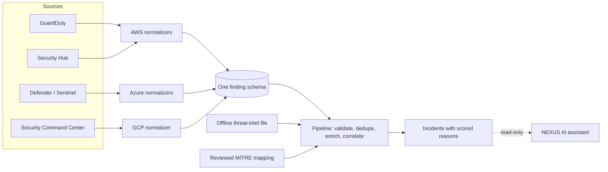

# AEGIS-X: multi-cloud security detection and correlation

[](https://github.com/touc996-svg/aws-cloud-security-monitoring/actions/workflows/aegis-x-validation.yml)
[](https://github.com/touc996-svg/aws-cloud-security-monitoring/actions/workflows/aegis-x-iac-security.yml)

AEGIS-X takes security findings from **AWS, Azure and Google Cloud**, converts them to one schema, removes duplicates, enriches them with threat intelligence and ATT&CK techniques, and groups related findings into a single **cross-cloud incident** with a plain explanation of why they were grouped.

It is built as a portfolio project: everything is tested and runs offline for free. The cloud infrastructure is written as Terraform but **deliberately not deployed**, because it is billable (see [Status](#status-what-is-and-is-not-done)).

## Try it in 30 seconds (no cloud account, no cost)

```bash
git clone https://github.com/touc996-svg/aws-cloud-security-monitoring.git
cd aws-cloud-security-monitoring/aegis-x
pip install -r demo/requirements.txt
python demo/run_demo.py
```

One simulated command-and-control callback is reported by four sources: GuardDuty, Security Hub (re-reporting the same GuardDuty finding), Microsoft Defender for Cloud and Google Security Command Center. The demo normalizes all of them, collapses the duplicate, matches the shared IP against an offline threat-intel file, and prints one incident:

```
2. Validate, deduplicate, enrich
   records ingested ........ 5  (quarantined: 0)
   duplicates collapsed .... 1  (Security Hub re-reports the GuardDuty finding)
   findings after dedup .... 4
   threat-intel matches .... 3  (offline indicator file)

3. Correlate across clouds
   inc-ac5c72522a2521fe  severity=HIGH  clouds=aws,azure,gcp  score=65
   shared indicator: 203.0.113.50
   timeline:
     10:00:00Z  aws   guardduty                high  EC2 instance i-0demo0001 is querying a domain name a
     10:12:00Z  azure defender-for-cloud       high  Communication with a known malicious IP address dete
     10:20:30Z  gcp   security-command-center  high  Malware: Bad IP

4. Left alone (no link to anything else)
   aws   low      Unprotected port on EC2 instance i-0demo0099 is being probed.
```

The sample data uses fake account IDs and the documentation-only IP range `203.0.113.0/24`.

## How it works



| Part | Where | What it does |
|---|---|---|
| Normalizers | [`aegis-x/integrations/`](aegis-x/integrations) | Pure Python, standard library only. Keep the original provider payload, native ID and native severity next to the normalized fields. Deterministic IDs, so re-processing is safe. |
| Pipeline | [`aegis-x/pipeline/`](aegis-x/pipeline) | Validates against the JSON schema (bad records are quarantined with a reason, never dropped), de-duplicates across sources, enriches with threat intel and ATT&CK, correlates into incidents with a transparent score. Output is byte-identical on every run. |
| AWS ingestion | [`aegis-x/terraform/aws-ingestion/`](aegis-x/terraform/aws-ingestion) | EventBridge to Lambda to an encrypted S3 bucket with a dead-letter queue. Idempotent writes. |
| Infrastructure as code | [`aegis-x/terraform/`](aegis-x/terraform) | AWS governance (Config, Security Hub, account-wide S3 block), AWS ingestion, Azure (Sentinel, Defender) and GCP (Security Command Center, audit-log sink) modules. |
| Validation | [`aegis-x/validation/`](aegis-x/validation) | End-to-end, recovery, governance and security-control tests. |
| NEXUS AI integration | [NEXUS AI](https://github.com/touc996-svg/nexus-ai) | A separate project (FastAPI, three agent domains). A read-only layer lets its cybersecurity agent summarize and explain AEGIS-X incidents. |

## Design decisions worth reading

- **Evidence is never lost.** Every finding keeps its raw provider payload, native ID and native severity. Tests assert the stored payload is identical to what the provider sent.
- **Offline by construction.** The normalizers and pipeline cannot import network or cloud SDKs, and a test fails if one does. The only code that touches AWS is the ingestion Lambda, which imports `boto3` lazily and has no destructive calls.
- **Idempotent and replayable.** Finding IDs are deterministic and storage keys derive from them, so a redelivered event or a dead-letter replay never duplicates anything. One failed write never blocks the others. State can be rebuilt from storage with identical results.
- **Honest about gaps.** Fields are never invented. MITRE techniques come only from provider data or an explicit, justified mapping table, and unmapped types stay unmapped.
- **Cost and safety by default.** Every billable Terraform resource sits behind an `enable_*` switch that defaults to off, and tests enforce it. Day-to-day work uses an IAM Identity Center (SSO) role instead of root, and a read-only check confirms root has MFA and no access keys.
- **The assistant is read-only.** NEXUS can query and explain findings but has no cloud credentials and no way to execute actions. Any future response automation needs approvals, an audit trail and rollback.
- **Tests that can fail.** I broke controls on purpose (a billable default, an S3 public-access block, a forbidden import) to confirm the tests catch each one.

## Status: what is and is not done

| Area | Status |
|---|---|
| Normalizers (GuardDuty, Security Hub, Sentinel, Defender, SCC) | Built and tested. GuardDuty also verified against 50 real findings from my own account (sample findings). |
| Cross-cloud pipeline | Built and tested |
| Terraform modules (AWS, Azure, GCP) | Written, formatted, validated, Checkov-clean, **not applied** (billable) |
| Live AWS account | GuardDuty, CloudTrail, SSO login and an account-wide S3 block are live; [`verify-controls.sh`](aegis-x/scripts/verify-controls.sh) checks them read-only |
| Azure and GCP | Offline only: no Azure subscription and no GCP project, so these were never run against real services |
| Automated incident response | **Not built, by design** |
| Data | Tests use hand-built or sample findings, not real attacks |

## Tests

```bash
cd aegis-x
pip install -r validation/requirements.txt
python -m pytest -q validation integrations/tests pipeline
```

CI runs formatting, validation and [Checkov](https://www.checkov.io/) on every Terraform module, plus all tests.

## Where this started

The repository began as a hands-on AWS monitoring project: CloudTrail, GuardDuty, EventBridge and SNS email alerts, with a CloudFormation template and an incident response runbook. That work is preserved: [original project README](docs/aws-security-monitoring.md), [runbook](docs/incident-response-runbook.md), [`infrastructure/guardduty-cloudwatch.yaml`](infrastructure/guardduty-cloudwatch.yaml).

## Author

Jacques Hugo St Cyr
